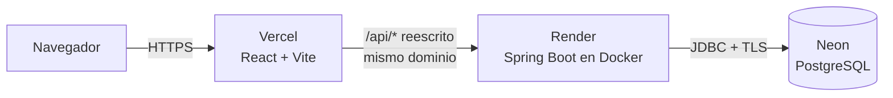
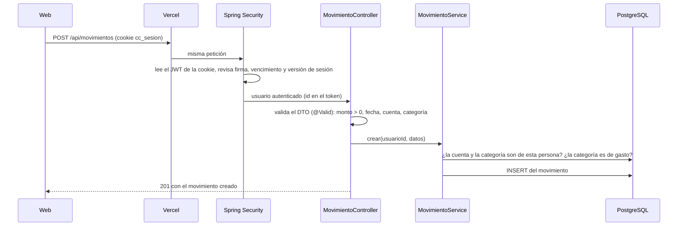

# CuentasClaras: arquitectura

Cómo está armada la aplicación y por dónde pasa una petición. Las razones de cada decisión están en [03-decisiones.md](03-decisiones.md).

## 1. Las piezas



| Pieza | Qué hace | Tecnología |
|---|---|---|
| Web | Pantallas, gráficas, formularios | React 19, Vite 8, Tailwind 4, Recharts |
| Puente | Vercel reescribe `/api/*` hacia Render. Para el navegador todo es un solo sitio, así que la cookie es de primera parte y no hace falta CORS | `frontend/vercel.json` |
| API | Reglas de negocio, seguridad, reportes | Spring Boot 4, Java 21, Spring Security (servidor de recursos JWT) |
| Base de datos | Datos de cada persona | PostgreSQL en Neon, migraciones con Flyway |

## 2. Organización del backend

Un paquete por **tema** del negocio, no por capa técnica. Cada paquete tiene su controlador, su servicio y sus DTO; al abrir `deuda/` está todo lo de deudas.

```
co.cuentasclaras
├── auth/          registro, login, cookie de sesión, mis datos, borrar cuenta
├── usuario/       entidad Usuario y BorradoDeDatos (único lugar que sabe el orden de borrado)
├── cuenta/        efectivo, Nequi, banco… (saldo calculado, nunca guardado)
├── categoria/     categorías por defecto y propias, con color
├── movimiento/    ingresos y gastos, filtros, paginación, exportar CSV
├── transferencia/ dos movimientos en una sola transacción
├── presupuesto/   sobres del mes por categoría y alertas
├── resumen/       totales del mes y evolución de 6 meses
├── deuda/         personas, deudas y abonos
├── pagofijo/      pagos que se repiten cada mes
├── meta/          metas de ahorro y aportes
├── demo/          datos de ejemplo (solo con el perfil demo)
└── comun/         seguridad, manejo de errores, Pesos, Meses (hora de Colombia)
```

**Acceso a datos.** Los módulos originales (cuentas, categorías, movimientos, presupuestos, usuarios) usan JPA con `ddl-auto: validate`: Hibernate comprueba que las entidades coincidan con las tablas, pero nunca las cambia; eso solo lo hace Flyway. Los módulos nuevos (deudas, pagos fijos, metas) y los reportes usan `JdbcTemplate` con SQL escrito a mano (ver decisión D-05).

**Errores.** Un manejador global convierte las excepciones en respuestas `ProblemDetail` (RFC 9457): 400 con los campos que fallaron, 404 cuando el recurso no existe o es de otra persona, 409 en conflictos (por ejemplo, un pago fijo que ya se pagó este mes) y 429 con demasiados intentos de inicio de sesión.

## 3. Recorrido de una petición con sesión

Ejemplo: registrar un gasto.



El `id` de la persona **siempre sale del token**, nunca del cuerpo ni de la URL. Todas las consultas filtran por `usuario_id`, así nadie llega a datos ajenos cambiando un número.

## 4. Sesión

- Al iniciar sesión, la API firma un JWT (HS256) y lo envía en la cookie `cc_sesion`: `HttpOnly` (ningún script la lee), `Secure`, `SameSite=Strict` y `Path=/api`. El cuerpo de la respuesta no trae el token.
- El token lleva un claim `v` con la **versión de sesión** de la persona. Al cambiar la clave, la versión sube y las sesiones abiertas con la clave anterior dejan de servir en todos los dispositivos (`ValidadorDeVersionDeSesion`).
- `BearerTokenResolver` lee primero la cookie y luego el encabezado `Authorization`. En login, registro, logout y salud **ignora la cookie**: una cookie vencida no debe impedir volver a entrar.
- Inicio de sesión limitado: 10 intentos fallidos por cuenta cada 15 minutos (`LimitadorDeIntentos`). Después responde 429.
- Contraseñas con BCrypt, de máximo 72 bytes, que es lo que BCrypt tiene en cuenta.

## 5. Frontend

- `SesionContext` es la única fuente de verdad de la sesión. Si en este navegador nunca hubo sesión (marca `cc_hubo_sesion`, sin ningún dato), la página pública se muestra de inmediato y la API se despierta en segundo plano.
- **Carga por partes:** de entrada solo bajan la página de inicio y el acceso (75 KB comprimidos). El panel y Recharts llegan con `React.lazy` al iniciar sesión.
- `api/cliente.js` centraliza `fetch`: rutas relativas `/api` (la cookie viaja sola porque es el mismo sitio) y errores `ProblemDetail` convertidos en mensajes en español.
- `MetaPagina` pone el título de cada pantalla. Las pantallas con sesión llevan `noindex` y las públicas, `canonical`.

## 6. Despliegue

| Dónde | Cómo |
|---|---|
| Render | `backend/Dockerfile` en dos etapas (JDK para compilar, JRE para correr) con **CDS**: un arranque de ensayo al construir la imagen deja lista la caché de clases y el arranque real es más corto. Registros en JSON (ECS) con el perfil `prod`. |
| Vercel | Construye `frontend/`, reescribe `/api/*` hacia Render, envía la CSP y guarda en caché por un año los archivos con hash. |
| Neon | PostgreSQL con TLS. Flyway aplica las migraciones `V1`–`V4` al arrancar. |
| GitHub Actions | Tres trabajos en cada PR: backend (Maven + Testcontainers), frontend (oxlint, Vitest, build) y de punta a punta (Playwright + axe contra el jar real). Dependabot agrupa las actualizaciones menores. |

El plan gratuito de Render apaga la API tras 15 minutos sin uso; encenderla tarda alrededor de un minuto. Por eso la web despierta la API apenas se abre y explica la espera en lugar de quedarse en blanco.
